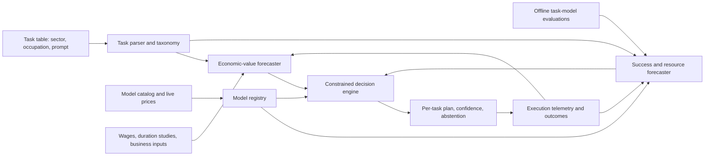

# Plan: Economic-Value and Model-Selection System for GDPVal-Style Tasks

_Designed August 5, 2026_

## 1. Objective

Build an ML system that accepts:

1. a task table with `sector`, `occupation`, and `prompt` fields, matching columns 2–4 of `output_data.csv`; and
2. a dynamic catalog of candidate models, such as the [Fireworks model library](https://fireworks.ai/models), including model capabilities, context limits, availability, and current prices.

For every task, the system produces:

- a forecast of the task's gross economic value in US dollars;
- a maximum permitted AI execution cost equal to exactly 10% of that forecast;
- the best eligible model or model-based execution plan;
- expected task success, execution cost, latency, and net economic value;
- confidence intervals and an auditable explanation of the decision; and
- an abstention when no model meets the cost, quality, or policy constraints.

The central design principle is that **economic value and model quality must be independently estimated**. A model should not be chosen merely because its token price is low, and economic value should not be inferred from prompt length.

## 2. Dataset observations

The supplied CSV contains 220 tasks, 9 sectors, and 44 occupations. Each occupation appears to have five tasks. The median prompt length is approximately 2,024 characters. The three requested inputs are:

| CSV column | Field | Role in the system |
|---:|---|---|
| 2 | `sector` | Industry priors, regulatory/risk context, and labor-market mapping |
| 3 | `occupation` | Wage, benefit-load, task-duration, and skill priors |
| 4 | `prompt` | Task requirements, modality, complexity, expected output, and risk features |

The existing dataset also contains reference files, expected deliverables, and rubrics. Those should be used during training and evaluation when available, even though production inference must support the requested three-column minimum.

## 3. Define the quantities correctly

### 3.1 Gross economic value

For task \(i\), forecast the value of one correct, accepted completion:

\[
V_i = V_{labor,i} + V_{speed,i} + V_{quality,i} + V_{revenue,i} - R_{failure,i}
\]

The first production version should be conservative and focus on defensible labor substitution or augmentation:

\[
V_{labor,i} = T_i \times W_i \times L_i \times A_i
\]

where:

- \(T_i\): estimated human hours to complete and review the task;
- \(W_i\): occupation-specific hourly compensation;
- \(L_i\): geographic and employer burden multiplier for benefits and overhead;
- \(A_i\): realizability factor, the share of theoretical time savings that becomes economic benefit.

The realizability factor prevents the system from equating every saved hour with a dollar of cash savings. For example, use separate calibrated priors for:

- **replacement value**: work is avoided or external spend is displaced;
- **capacity value**: employees use saved time for other productive work;
- **speed value**: earlier completion creates measurable revenue or risk benefit; and
- **compliance value**: a correct task reduces expected loss, but requires stronger evidence.

All values should be reported as a P10/P50/P90 range. The decision ceiling should default to the conservative P10 value until calibration demonstrates that P50 is safe.

### 3.2 Cost ceiling

The requested maximum cost is:

\[
B_i = 0.10 \times V_i
\]

Store both:

- `max_cost_p50_usd = 0.10 × value_p50_usd`; and
- `operational_budget_usd = 0.10 × value_p10_usd`.

This preserves the flat 10% policy while avoiding decisions based on an overconfident point estimate. The cost must include the entire successful attempt, not only the first API response:

\[
C_{i,m}=C_{input}+C_{output}+C_{cached}+C_{tools}+C_{retries}+C_{validation}+C_{human\ review}
\]

### 3.3 “Best model”

Define best as the model or execution plan with the greatest risk-adjusted net value, subject to hard constraints:

\[
m_i^* = \arg\max_m
\left[P(success\mid i,m)\times V_i-C_{i,m}-E(loss\mid i,m)\right]
\]

subject to:

\[
C_{i,m} \le B_i,
\quad P(success\mid i,m) \ge q_i,
\quad latency_{i,m} \le l_i,
\quad policy(i,m)=allowed
\]

The quality threshold \(q_i\) should rise with task stakes. If no candidate passes, output `ABSTAIN`, not the cheapest model.

## 4. System architecture



The implementation has six separable components.

### Component A: Task parser and taxonomy

Convert each prompt into a structured task profile:

- task family: extraction, analysis, writing, spreadsheet manipulation, coding, research, planning, media generation, or mixed;
- required modalities: text, vision, documents, spreadsheets, audio, or video;
- required tools and artifact types;
- context and estimated output-token ranges;
- number of likely agent steps and tool calls;
- domain, occupation, and sector;
- factuality, mathematical, formatting, and instruction-following demands;
- stakes: ordinary, consequential, regulated, or safety-critical;
- privacy/data-residency constraints; and
- estimated human duration and review burden.

Use a constrained JSON extraction model initially, followed by deterministic validators. Later, train a multi-label encoder on reviewed task profiles. Keep the original prompt and extraction evidence for auditability.

### Component B: Dynamic model registry

Ingest the Fireworks catalog through its management API or a scheduled catalog snapshot. Calls to the Models API are documented as free, while inference is billed separately. The registry should version:

- canonical model ID and revision;
- serverless, on-demand, or reserved availability;
- input, cached-input, and output prices;
- context length and output limits;
- supported modalities, tool calling, and structured output;
- service tier and expected latency;
- region, privacy, license, and deployment restrictions; and
- effective dates for every price/capability record.

Do not hard-code today's catalog. As examples only, the current public library displays models including GLM 5.2, Kimi K2.7 Code, MiniMax M3, DeepSeek V4 Pro/Flash, Qwen 3.7 variants, and Kimi K2.6, with materially different prices and capabilities. Fireworks also distinguishes per-token serverless pricing from GPU-time-based deployments. See the [model library](https://fireworks.ai/models), [serverless pricing documentation](https://docs.fireworks.ai/serverless/pricing), and [pricing page](https://fireworks.ai/pricing).

### Component C: Economic-value forecaster

Use a hierarchical probabilistic model rather than a single LLM estimate.

**Inputs**

- occupation and sector;
- prompt-derived task family and complexity;
- expected deliverable and modality;
- external compensation data, ideally BLS occupation wages plus employer-cost load;
- human task-duration labels;
- customer-specific labor rates and value-realization assumptions when available; and
- task stakes and expected error cost.

**Model design**

1. Predict human completion time with a log-normal or survival model.
2. Map occupation to loaded hourly compensation.
3. Predict necessary human review time separately.
4. Apply a configurable realizability factor.
5. Add revenue, speed, or risk value only when customer data supports it.
6. Use conformal calibration or posterior intervals to emit P10/P50/P90.

Start with a transparent generalized additive or hierarchical Bayesian model. It will extrapolate more safely across sparse occupation/task combinations than a high-capacity black box and will expose which assumptions drive value. A language model may generate features, but it should not be the final dollar-value estimator.

### Component D: Task-model performance and resource forecaster

For every eligible task-model pair, predict:

- probability of rubric-level success;
- probability of severe failure;
- input, cached, reasoning, and output tokens;
- tool calls and retry probability;
- end-to-end latency; and
- total machine and review cost.

Train this component on actual executions. Run each candidate model multiple times per representative task because model outputs and agent trajectories are stochastic. Score GDPVal tasks against their supplied rubrics and deliverables using a combination of deterministic checks, domain-specific validators, and blinded human review. An LLM judge may assist but must be calibrated against humans and must not be the sole ground truth.

A practical model is a hierarchical gradient-boosted model or Bayesian matrix-factorization model with:

- task features;
- model capability and price features;
- task-family × model interactions;
- observed execution settings; and
- model-version random effects.

This enables predictions for newly listed models from capability priors while widening uncertainty until empirical results arrive.

### Component E: Constrained optimizer

For each task:

1. Filter models that cannot support the required modality, context, tools, region, or policy.
2. Estimate success, severe-failure probability, tokens, latency, and full execution cost.
3. Remove candidates whose P90 cost exceeds the operational budget.
4. Remove candidates below the task's calibrated quality floor.
5. Rank survivors by conservative expected net value.
6. Return the best candidate plus the next two alternatives.
7. Abstain when uncertainty or constraint violations are material.

The candidate may be an execution **plan**, not just one model. For example, a lower-cost worker plus a stronger validator may produce higher success at lower expected cost than a premium model alone. Keep a `single_model_only` configuration if the product requirement literally demands one model.

### Component F: Monitoring and learning loop

Capture realized data after deployment:

- selected model and version;
- predicted and actual tokens/cost/latency;
- acceptance, corrections, retries, and human review time;
- rubric or business outcome;
- estimated realized value; and
- model/catalog changes.

Use this for calibration, drift detection, and scheduled retraining. Trigger immediate re-evaluation when prices, model revisions, or model availability change.

## 5. Output contract

Produce one record per `task_id`:

```json
{
  "task_id": "83d10b06-26d1-4636-a32c-23f92c57f30b",
  "task_profile": {
    "sector": "Professional, Scientific, and Technical Services",
    "occupation": "Accountants and Auditors",
    "task_family": ["spreadsheet", "quantitative_analysis", "audit"],
    "risk_tier": "regulated",
    "required_modalities": ["text", "spreadsheet"]
  },
  "economic_value": {
    "currency": "USD",
    "p10": 0.0,
    "p50": 0.0,
    "p90": 0.0,
    "method": "loaded_labor_value",
    "assumptions": {
      "human_hours_p50": 0.0,
      "loaded_hourly_cost": 0.0,
      "realizability_factor": 0.0
    }
  },
  "cost_policy": {
    "max_cost_p50_usd": 0.0,
    "operational_budget_usd": 0.0,
    "budget_fraction": 0.10
  },
  "recommendation": {
    "status": "RECOMMEND_OR_ABSTAIN",
    "model_id": "accounts/provider/models/model-name",
    "service_tier": "standard",
    "expected_success_probability": 0.0,
    "severe_failure_probability": 0.0,
    "expected_total_cost_usd": 0.0,
    "p90_total_cost_usd": 0.0,
    "expected_latency_seconds": 0.0,
    "expected_net_value_usd": 0.0,
    "rationale": [],
    "alternatives": []
  },
  "provenance": {
    "value_model_version": "",
    "performance_model_version": "",
    "catalog_snapshot_at": "",
    "generated_at": ""
  }
}
```

Never fill unknown dollar fields with invented precision. Until sufficient evidence exists, emit wide intervals and `NEEDS_VALUE_INPUT` or `NEEDS_BENCHMARK` statuses.

## 6. Data and labeling program

### Economic-value labels

Collect at least three independent estimates for a stratified subset of tasks:

- occupation expert's expected completion time;
- observed completion time from practitioners;
- manager's estimate of review time and realizable value; and
- external wage/benefit data keyed by occupation and geography.

The 220 GDPVal tasks are enough for a pilot but too small to identify robust effects for all task types and new occupations. Add customer tasks and repeated human measurements. Five tasks per occupation provide weak within-occupation coverage, so uncertainty must remain hierarchical and explicit.

### Model-performance labels

For each model/task cell in the pilot:

- run at least 3–5 independent trials;
- hold agent scaffold, tools, temperature, and budgets constant where possible;
- retain artifacts and execution traces;
- score every rubric dimension;
- perform human adjudication on disagreements; and
- measure full execution cost, including failures and validation.

Use adaptive evaluation after the first broad sweep: allocate more trials near the quality/cost decision boundary and fewer to clearly dominated candidates.

## 7. Evaluation protocol

Avoid random row splits alone because tasks from the same occupation may be similar. Report:

- leave-one-occupation-out performance;
- leave-one-sector-out performance;
- chronological holdout for new model versions;
- performance on unseen task families; and
- customer-specific out-of-distribution tests.

### Value-forecast metrics

- median absolute percentage error for human time and economic value;
- P10/P50/P90 interval coverage and width;
- calibration by occupation, sector, and task family; and
- rate at which the 10% budget is overstated.

### Model-selection metrics

- task success and severe-failure rate;
- regret versus an oracle that knows realized outcomes;
- cost per accepted task;
- budget violation rate using full cost;
- selection stability across repeated runs;
- abstention precision and coverage; and
- net value relative to premium-only, cheapest-only, and rules-based baselines.

The primary launch metric should be **risk-adjusted net value per task at an enforced budget-violation and severe-failure ceiling**.

## 8. Delivery phases

### Phase 0 — Policy and definition (1–2 weeks)

- Agree on whether economic value means labor capacity, cash savings, revenue, avoided loss, or a declared combination.
- Set geography, loaded compensation, realizability factors, and risk tiers.
- Define minimum quality and severe-failure thresholds.
- Decide whether the 10% ceiling applies to P10 or P50 value; recommend P10 operationally.

**Exit:** signed metric and policy specification.

### Phase 1 — Deterministic baseline (2–3 weeks)

- Parse the 220 tasks into a reviewed taxonomy.
- Build versioned Fireworks catalog ingestion.
- Join public compensation priors.
- Create transparent human-time heuristics and value ranges.
- Estimate cost from prompt/output-token ranges.
- Produce per-task recommendations using explicit rules and abstentions.

**Exit:** auditable plan for all 220 tasks, clearly labeled as baseline estimates rather than learned truth.

### Phase 2 — Evaluation harness (3–6 weeks, cost dependent)

- Execute a stratified model × task matrix.
- Score existing rubrics and artifacts.
- Collect human timing and review labels.
- Establish premium-only, cheapest-only, and rules-router baselines.

**Exit:** sufficient empirical coverage to estimate success and cost with useful intervals.

### Phase 3 — Learned forecasters and optimizer (3–5 weeks)

- Train and calibrate economic-value and task-model outcome models.
- Implement the constrained optimizer.
- Backtest on held-out occupations, sectors, and newer models.
- Add explanations, alternatives, and abstention reasons.

**Exit:** offline launch thresholds met.

### Phase 4 — Shadow deployment (4+ weeks)

- Generate recommendations without controlling production traffic.
- Compare predictions with actual expert/model execution.
- Measure drift, budget violations, and downstream errors.
- Recalibrate thresholds and intervals.

**Exit:** governance approval for bounded production use.

### Phase 5 — Controlled rollout

- Begin with low-risk task families.
- Enforce hard spend limits and policy overrides.
- Require human review for consequential work.
- Expand only when segment-level performance remains calibrated.

## 9. Important failure modes

- **Value hallucination:** an LLM invents plausible wages, duration, or business impact. Mitigate with sourced data, explicit assumptions, and intervals.
- **False precision:** `$183.42` appears authoritative despite weak inputs. Round estimates and expose confidence.
- **Prompt-length proxy:** long prompts are not necessarily more valuable or harder.
- **Cheap-model bias:** per-token price ignores retries, longer outputs, tool loops, and review.
- **Benchmark leakage:** model familiarity with benchmark-style tasks inflates expected production performance.
- **Judge bias:** an evaluator model favors its own style or model family.
- **Missing modality:** columns 2–4 do not reveal attachment contents; inspect metadata or abstain when files are required.
- **Non-realizable savings:** saved employee time is counted as cash without a capacity or workforce plan.
- **Tail risk:** average quality hides rare, expensive failures in regulated work.
- **Catalog drift:** recommendations become stale as prices, versions, and availability change.

## 10. Recommended MVP decision

Build the first release as a **decision-support planner**, not an autonomous router. Its output should say:

> Given sourced labor-cost assumptions and measured model trials, this task has an estimated P10/P50/P90 value of X/Y/Z, an operational AI budget of 10% of P10, and model M maximizes conservative expected net value while meeting the quality threshold. Confidence is C; otherwise abstain.

The MVP is successful only if users can trace each recommendation back to:

1. the task classification;
2. the human-time and compensation assumptions;
3. the exact 10% calculation;
4. current model prices and capabilities;
5. empirical model performance on comparable tasks; and
6. the constraints that admitted or rejected each candidate.

That produces a system whose economic forecasts can be challenged and improved, rather than a model picker that converts uncertain assumptions into deceptively precise dollar values.

## Sources

- Fireworks AI, [Model Library](https://fireworks.ai/models), accessed August 5, 2026.
- Fireworks AI, [Serverless Pricing](https://docs.fireworks.ai/serverless/pricing), accessed August 5, 2026.
- Fireworks AI, [Pricing](https://fireworks.ai/pricing), accessed August 5, 2026.
- Fireworks AI, [Billing management](https://docs.fireworks.ai/faq/billing-pricing-usage/billing/billing-management), accessed August 5, 2026.
- Local input: `/Users/manyam2025/src/hf-evals/gdpval/output_data.csv`.
